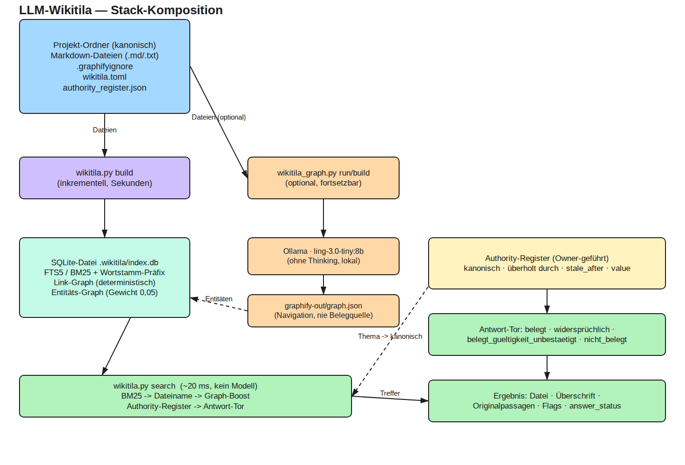

# LLM-Wikitila

**Fast, evidence-backed search + local knowledge graph for any project folder** — no vector store, no cloud, no model in the runtime path.

LLM-Wikitila makes a project folder (second brain, documentation folder, Markdown vault) searchable in seconds and returns **evidence-backed answers instead of mere hits**: file, heading, and the original passage, with authority, supersession, and freshness checks. An optional local knowledge graph (Graphify + a small local model) adds navigation and cross-references — it is never the source of truth for answers.

> Deutsche Version: [README.md](README.md)

## Evidence-backed benefits (measured)

| Benefit | Measurement |
|---|---|
| Hit rate | **R@10 1.00** on a 50-question catalog; `graphify query` (graph RAG) reaches 0.25 |
| Speed | ~20 ms per search, deterministic, no service, no GPU |
| Evidence instead of claims | Original passage + quote instead of a graph summary |
| Validity instead of relevance | The authority register resolves which source is canonical and still current |
| Controlled "not supported" | Signals for missing knowledge instead of a plausible wrong answer |
| No vector store required | SQLite FTS5/BM25 suffices; embeddings are measurably unnecessary |
| No model in the runtime path | Decision models measurably worsened ranking and answer gating |

Details and measurement limits: [docs/benefits.en.md](docs/benefits.en.md) · [docs/validation.en.md](docs/validation.en.md)

## Quick start

```bash
# 1. Set up inside a project folder (idempotent)
./install.sh /path/to/project-folder

# 2. Search (~20 ms)
python3 wikitila.py --root /path/to/project-folder search "What is the current price?" -k 5

# 3. Check coverage and freshness
python3 wikitila.py --root /path/to/project-folder manifest
python3 wikitila.py --root /path/to/project-folder check
```

Every answer carries `answer_status` (`belegt` · `widersprüchlich` · `belegt_gueltigkeit_unbestaetigt` · `nicht_belegt`), flags such as `kanonisch` / `überholt durch` / `veraltet`, and the original passages (`passages`).

## Installation

For humans: [docs/installation.en.md](docs/installation.en.md) — prerequisites, step by step, troubleshooting.
For AI agents: [AGENTS.md](AGENTS.md) — installation, usage, answer contract, and maintenance rules for agents.

## What's included

```
LLM-Wikitila/
├── wikitila.py                # Main tool: build · search · status · manifest · check · eval · embed
├── wikitila_graph.py          # Optional: local Graphify extraction (Ollama, no thinking)
├── validate_catalog.py        # Validation against a question catalog (3 measurement levels)
├── test_wikitila.py           # 18 unit tests (synthetic corpus, no network/Ollama)
├── install.sh                 # Installer for a target folder
├── config.example.toml        # Example configuration (→ wikitila.toml)
├── authority_register.example.json  # Template for the authority register
├── golden_catalog.example.jsonl     # Template for the question catalog
├── AGENTS.md                  # Agentic installation and operations guide
├── skills/llm-wikitila/       # Skill for AI agents (with reference)
├── diagrams/                  # Stack composition diagram (PNG + editable .excalidraw)
└── docs/                      # Documentation (German + English)
```

## Stack composition



Source: [diagrams/stack-komposition.excalidraw](diagrams/stack-komposition.excalidraw) — editable at [excalidraw.com](https://excalidraw.com) (drag and drop the file); regenerate with `diagrams/generate_diagram.py`. Component description: [docs/architecture.en.md](docs/architecture.en.md).

## Dependencies

| Component | Requirement | Required? |
|---|---|---|
| Python | **≥ 3.11** (standard library suffices for search) | yes |
| SQLite with FTS5 | included in Python ≥ 3.11 | yes |
| Ollama + `maternion/ling-3.0-tiny:8b` | only for the knowledge graph | optional |
| Graphify package (`pip install graphify`, `networkx`) | only for the knowledge graph | optional |
| `embeddinggemma:latest` (Ollama) + `numpy` | only for optional embeddings | optional |

No Docker, no vector-store service, no cloud. The search index is a single SQLite file inside the target folder (`.wikitila/index.db`).

## Documentation

| Topic | Deutsch | English |
|---|---|---|
| Installation | [docs/installation.de.md](docs/installation.de.md) | [docs/installation.en.md](docs/installation.en.md) |
| Architecture | [docs/architecture.de.md](docs/architecture.de.md) | [docs/architecture.en.md](docs/architecture.en.md) |
| Authority register | [docs/authority-register.de.md](docs/authority-register.de.md) | [docs/authority-register.en.md](docs/authority-register.en.md) |
| Operations | [docs/operations.de.md](docs/operations.de.md) | [docs/operations.en.md](docs/operations.en.md) |
| Validation | [docs/validation.de.md](docs/validation.de.md) | [docs/validation.en.md](docs/validation.en.md) |
| Evidence-backed benefits | [docs/benefits.de.md](docs/benefits.de.md) | [docs/benefits.en.md](docs/benefits.en.md) |

## License

[MIT](LICENSE) — open and commercially usable. Developed by AGANTILA as an LLM-wiki extension with Graphify and a measured evidence contract.
