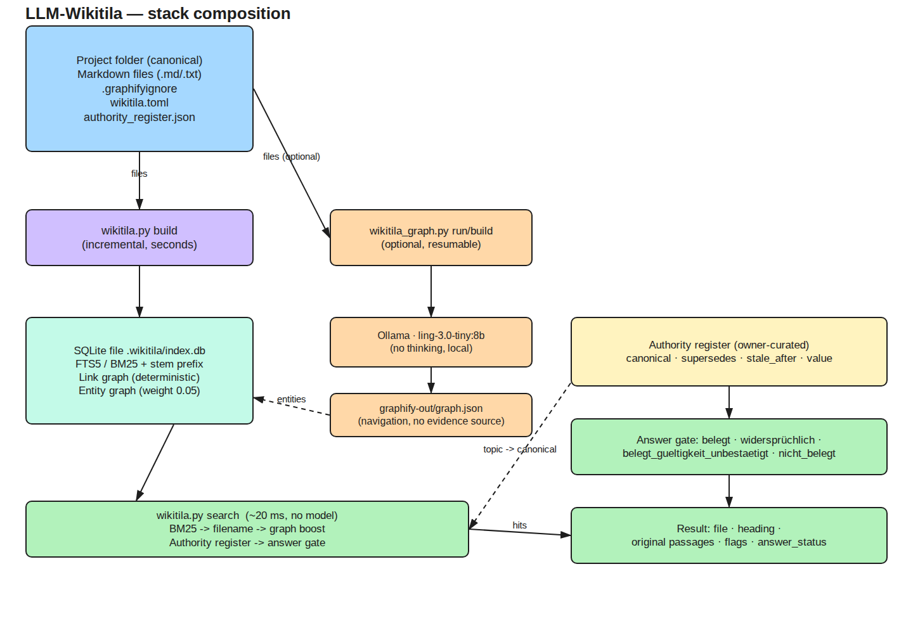

# Architecture (English)

LLM-Wikitila is a **local, evidence-oriented hybrid**: deterministic full-text search + authority/freshness resolution + an optional knowledge graph. Every component runs locally, without a service and without a model in the search runtime path.



*Stack composition: editable source [diagrams/stack-komposition.en.excalidraw](../diagrams/stack-komposition.en.excalidraw) (excalidraw.com, drag and drop); regenerate with [diagrams/generate_diagram.py](../diagrams/generate_diagram.py). German variant: [stack-komposition.png](../diagrams/stack-komposition.png).*

## Components

| Component | Role | Technique |
|---|---|---|
| **Search core** | Full-text ranking | SQLite FTS5 / BM25, stem-prefix, weights title 6 · heading 3 · body 1; section → file mapping in the indexed `chunks` table (ADR-002) |
| **Filename** | Makes identifiers findable (ADR numbers etc.) | Filename stem is indexed + small boost |
| **Link graph** | Deterministic links | Filenames, wikilinks, Markdown links, ADR numbers — no LLM |
| **Entity graph** | Small ranking boost | Graphify entities (document → entity), weight 0.05 |
| **Authority register** | Canonical source, supersession, validity | `authority_register.json` (owner-curated) |
| **Answer gate** | Four answer statuses + abstention signals | model-free, deterministic |
| **Source manifest** | Coverage report | `manifest` → `.wikitila/source_manifest.json` |
| **Index/source consistency** | Detect drift | `check` (new/changed/removed) |
| **Write side** | Frontmatter convention for new files | `lint` (required fields from `[lint]` in wikitila.toml, two tiers violation/note, same reading view as the index) |
| **Knowledge graph** (optional) | Navigation, cross-references, lint candidates | Graphify + small local model, no thinking |

From the frontmatter, the index reads only `title`, `description`, `status` and `superseded_by` — as flat `key: value` lines (no lists, no nesting). `tags`, `type` and other fields have no effect on search (they work e.g. in Obsidian). `lint` checks exactly this reading view: required fields (`require`) are parsed with the same logic as the build, so "lint-clean = index-optimal" holds by construction.

## Data flow

```
Project folder (Markdown, untouched, canonical)
   │  .graphifyignore (one exclusion list for search and graph)
   ▼
wikitila_graph.py (optional)        wikitila.py build
   Ollama without thinking              sections → FTS5/BM25
   document → entities                 link graph + entity graph
   ▼                                    ▼
graphify-out/graph.json            .wikitila/index.db (one SQLite file)
   (navigation: path, explain)         + authority_register.json (owner)
   ▼                                    ▼
wikitila.py search "question"
   BM25 → filename → graph boost → authority register → answer gate
   Output: file, heading, original passages, flags, answer_status
```

## Design decisions (with measurement evidence)

1. **No vector-store service.** 26,000 sections as vectors are 80 MB; brute force takes 25 ms. An embedding only helped in an early measurement with large sections (up to +0.18 MRR); the final pipeline reached R@10 1.00 without it. If ever needed: vectors as a table in the same SQLite file (optional, off).
2. **No model in the runtime path.** Decision models (`laya:latest`, `tev1:0.8b`) worsened ranking (MRR 0.659/0.617 vs. 0.794) and answer gating (AUC 0.70/0.78 vs. 0.94). Models are only used for the one-time graph build and an optional maintenance lint.
3. **Authority ≠ relevance.** BM25, link count, graph centrality, and date do not establish factual validity. Only the owner-curated register decides `canonical`/supersession/validity.
4. **RRF ≠ confidence.** The visible `score` is a rank value (Reciprocal Rank Fusion), not a probability. The answer gate uses `bm25_top` and structural signals, never the RRF value as a percentage.
5. **"Nothing found" ≠ "nothing exists".** Missing hits never justify a non-existence claim. The status is `nicht_belegt`, never "does not exist".
6. **Evidence-backed answer as the unit of acceptance.** A correct file without the answer-bearing passage is not a hit. Therefore up to three original passages are returned per file.

## Answer contract

| Status | Meaning |
|---|---|
| `belegt` | File, heading, and quoted original passage present |
| `widersprüchlich` | Multiple values found; resolution visible (`überholt durch`, `kanonisch`) |
| `belegt_gueltigkeit_unbestaetigt` | Evidence present, factual validity open (`proposed`, unconfirmed) |
| `nicht_belegt` | No reliable answer in the repository |

Signals for the agent: `unmatched_terms` (term missing from the whole corpus), `top1_missing_terms` (term missing from the top-1 result), `term_coverage`/`uncovered` (coverage grade: which term has no co-located evidence in the same chunk — analogous to Auto Ontology's `check_answerable`), `bm25_top` (raw relevance value), and `trace` (resolved register rules and the answer gate's reason). Near-topic questions ("safe zones for Pinterest") cannot be rejected lexically without semantics — the agent decides the abstention based on these signals; the coverage grade makes it verifiable. Check coverage without ranking first with `wikitila.py coverage "question"`.
